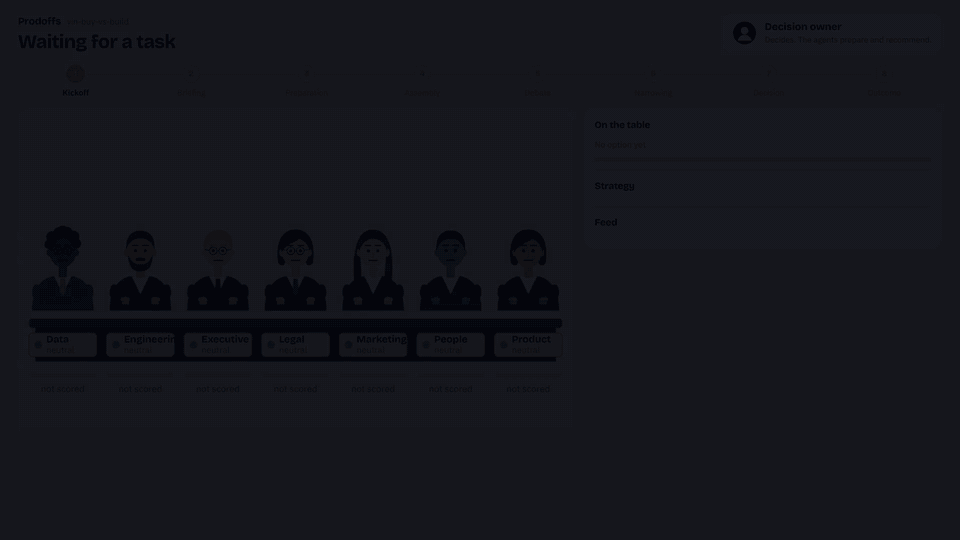

# Prodoffs



Prodoffs helps a product leader decide **what goes into the quarterly roadmap and what stays out**, with the strategic bets and the guardrails in view. Role agents (Executive, Product, Engineering, Marketing, Data, Legal, People) argue the portfolio from their own stake, score each option against their own requirements, and look for a plan the company can live with. **The human decides.** You set the bets, the limits, the candidate initiatives and the capacity. You answer the open questions and give the final yes or no. The agents make the trade-offs visible and show what each cut costs later.

## The problem it solves

A roadmap is a set of trade-offs that look fine one at a time:

- Every initiative saves time now. Together they create shortcuts that block a strategic bet later, for example a hardcoded pricing rule that stops a new market launch.
- Capacity is shared. Taking one initiative quick often takes time from another.
- Guardrails (one-off spend, run cost, payback) are checked per decision, not per plan.

Prodoffs checks the plan as a whole: each option is a full choice of one version per initiative, and the script tests it against capacity, every bet and every guardrail at once.

## How it works

1. **You give it your context.** The strategy, the candidate initiatives, the team's capacity, and the sources behind them. `prodoffs-intake` can draft this from your Slack, email, Google Docs and files.
2. **The roles debate.** Each role argues its own position, scores every option, and proposes a compromise where it sees one.
3. **The script checks the plan.** It tests every option against capacity, red lines, guardrails and strategic bets, and computes how far each role moved from its opening position.
4. **You get the trade-offs, option by option.** You decide. If the roles agree, you confirm. If they do not, you choose from the options on the table.

The sections below go from the result you get, to the rules behind it, to what you fill in.

## What you get back

Prodoffs does not make the decision. It lays out what each option costs and who pays, so the product lead can decide.

For every option in the plan:

- **Trade-offs by role.** Each role's score, its deviation from its opening position, and its tolerance. You see who gives up what, and who is pushed beyond their tolerance.
- **Red lines.** Any role that cannot accept the option, and the rule it would break. Vetoes are shown as vetoes.
- **Guardrails.** One-off investment, monthly run cost and payback, against their limits, with the numbers.
- **Strategic bets.** Each bet as on track, at risk, or blocked, and the shortcut behind it.
- **Capacity.** Team-weeks used against the available total.
- **Shortcuts.** What each version saves now, what it costs later, and which bets it blocks.
- **Dissent.** The strongest losing argument for each rejected option, with a measurable condition for reopening it.

The result is a status, not a decision. "No agreement" means the decision owner chooses, from the option map above. The chosen option, any override and the reason are recorded with the dissent, so the next decision can see them.

## Roles

Each role is one file in `.claude/agents/`. Adding a role means adding one file (`prodoffs-add-role`).

| Role | Argues for |
|---|---|
| Executive | The business result, staying inside guardrails, strategic fit |
| Product | Customer value delivered fast and right; the market window |
| Engineering | Sustainable pace, reversible decisions, no hidden debt |
| Marketing | A story the market believes and a promise the product can keep |
| Data | Reusable data, trusted metrics, launches that can be measured |
| Legal | Decisions that are lawful, defensible and have an exit (included when relevant) |
| People | Plans the teams can staff and sustain (included when relevant) |

Legal and People take part only when the plan depends on them. Market research, legal analysis and effort estimates are part of each role's playbook, not separate skills. The human provides the raw material in `evidence/`.

## The decision rules

- **Consensus.** The plan fits capacity, breaks no red line, breaks no guardrail, creates no new risk for a strategic bet, and every role is within its tolerance (default 20%, tighter for a role that conceded recently).
- **Compromise.** Only in the last round, among options that meet every hard condition: the one where the most unhappy role is least unhappy, with nobody beyond twice their tolerance.
- **Owner decides.** If neither exists, the decision owner chooses. The override is recorded.
- **Veto.** A red line marked `veto: true` cannot be lifted by an override. Legal's lawful-basis rule is one example.

Deviation is `1 - score(option) / score(own opening position)`, computed by `scripts/prodoffs.py` from each role's weighted requirements. Roles score, the script counts.

## Skills

| Skill | Use |
|---|---|
| `prodoffs-setup` | Create a workspace for your product by interview |
| `prodoffs-intake` | Build a workspace from your sources (Slack, email, Google Docs, files) |
| `prodoffs-kickoff` | Frame the planning question: initiatives, capacity, owner, deadline |
| `prodoffs-business-case` | Build or update the numbers behind the initiatives |
| `prodoffs-deliberate` | Run the debate and the decision |
| `prodoffs-record` | Record the owner's decision in the ledger |
| `prodoffs-shortcut` | Log a shortcut the moment a team takes it |
| `prodoffs-radar` | Before planning: which bets are at risk from open shortcuts |
| `prodoffs-recall` | Why a past decision was made, who conceded |
| `prodoffs-retro` | Quarterly plan versus reality; did the shortcuts cost what we expected |
| `prodoffs-add-role` | Add a role as a single agent file |

## Quick start

```bash
pip install pyyaml
python3 scripts/prodoffs.py case examples/vin-buy-vs-build --dry-run
```

Open Claude Code in this repository and use `prodoffs-intake` to build a workspace from your sources, or `prodoffs-kickoff` on a planning question.

## Bootstrap: your own case

You start from the sources you already have: Slack threads, email, Google Docs, Drive folders, exported files. `prodoffs-intake` reads them, writes a digest of each for the roles, drafts the starting data and asks what is missing or conflicting. You decide what is true.

Using this tool well takes time spent adapting it to your own case. Be patient! :-)

### Run it

1. In Claude Code, open this repository and run `prodoffs-intake`.
2. Give a workspace name and list all your sources in one message: channel names, thread links, an email search, Google Doc links, Drive folders, files.
3. The skill reads what it can through the connectors available in your session. For anything it cannot read, it asks for an export.
4. Answer its questions in `workspaces/<name>/intake-questions.md`, in chat.
5. Check the draft files, run `python3 scripts/prodoffs.py validate workspaces/<name>`, and start the first decision with `prodoffs-kickoff`.

Re-run `prodoffs-intake` on the same workspace when sources change. It writes `intake-changes.md` and asks before it changes any field you have edited.

### What to fill in, and where

Every path is inside `workspaces/<name>/`. Intake drafts these files, and you correct them.

| File | What goes in |
|---|---|
| `strategy.yaml` | Goals with baseline and target; guardrails (one-off spend, monthly run cost, payback); 2 to 5 strategic bets for the next 12 to 18 months, concrete ("two new EU markets in H2", not "grow revenue") |
| `candidates.yaml` | Initiatives with quick and full versions, effort in team-weeks, and the shortcuts each version creates or fixes. Team capacity for the quarter in `capacity_team_weeks` |
| `memory/shortcuts.yaml` | Known shortcuts and tech debt, with the bets they block |
| `memory/decisions/`, `memory/concessions.yaml` | Past decisions and concession balances, if you have them; otherwise balances start at zero |
| `mandates/<role>.yaml` | Optional. Overrides a role's owned metrics, red lines or weights. Defaults live in the role files |
| `prodoffs.yaml` | Tolerance, fairness strength, maximum rounds |

Values taken from a source carry a `# source:` comment. Values not found are `TBD`.

### What intake produces

| Path | From |
|---|---|
| `sources/<source>.md` | Each source, raw, with a header: source, retrieval date, date range, authors. Not read by roles |
| `evidence/<source>.md` | A digest of the source, at most about 400 words: key facts, positions, open questions, and a pointer to the raw file. Read by roles |
| `strategy.yaml`, `candidates.yaml` | Drafted from the digests |
| `memory/shortcuts.yaml`, `memory/decisions/`, `memory/concessions.yaml` | Shortcuts, decisions and balances named in the sources |
| `intake-questions.md` | Missing values, conflicts between sources, assumptions to confirm |
| `intake-changes.md` | On a re-run: which sources changed and which draft fields they affect |

### Sources and what the roles see

Roles read files, not links. They read the digests in `evidence/`, which the skill writes from your sources. Each digest points to the raw file, so the full text is one step away when a role needs it.

The role agents have `Read`, `Write`, `Glob` and `Grep` (Engineering), and `WebSearch`/`WebFetch` for Product, Marketing and Legal. `WebFetch` reads public pages only, so private Google Docs and Slack threads will not open for them. The skill's connectors are used in the intake step in your main session, not by the roles during debate.

### Privacy

`workspaces/` is git-ignored. Raw sources can contain personal data and stay there. Do not copy them into `examples/` or `docs/`.

## Example

[`examples/vin-buy-vs-build`](examples/vin-buy-vs-build): a buy, build or hybrid decision for vehicle identification by VIN. A recorded run, stopped at the owner's decision. The case is fictional and its business case numbers are illustrative. Legal analysis is not legal advice.

## Memory and reset

`memory/` stores past shortcuts, concession balances (they tighten a role's future tolerance) and decisions. Demo runs write into it. To clear them:

```bash
python3 scripts/prodoffs.py reset examples/vin-buy-vs-build --memory
```

This restores `memory/` to the snapshot taken before the first recorded decision and deletes all sessions in that workspace. Copy any session you want to keep first.

## Repository layout

```
.claude/agents/    one agent file per role, plus the facilitator
.claude/skills/    the skills above
.claude/settings.json   hooks that show agent activity on the board
board/             live board of a session
docs/              role protocol, demo video
examples/          worked examples with inputs, memory and recorded sessions
scripts/           prodoffs.py: validate, case, score, brief, record, reset
templates/         starter workspace used by prodoffs-setup and prodoffs-intake
```

## Licence

MIT. See LICENSE.
