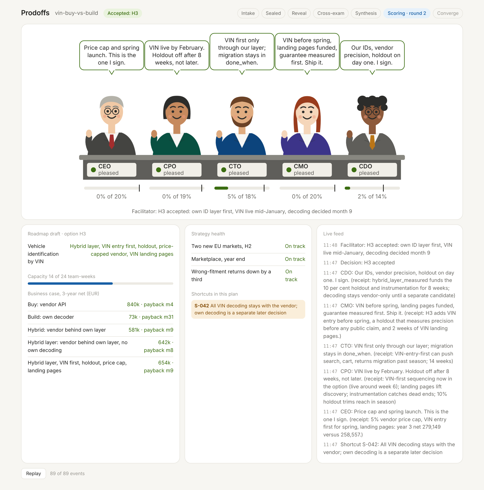
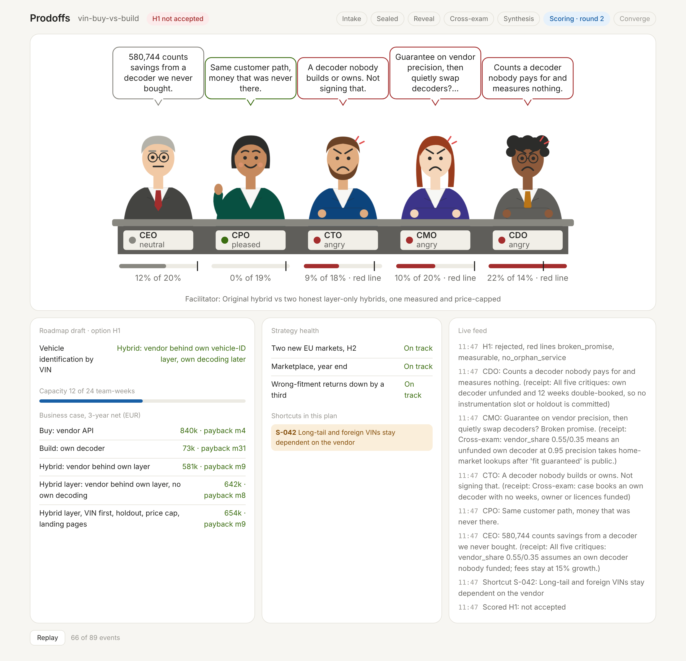

# Prodoffs

> Build a roadmap that wins this quarter without losing the next year.

Prodoffs is an open framework of Claude Code agents for product leaders. It remembers every trade-off the team has made, shows the future price of cutting corners, and helps assemble a quarterly roadmap that balances speed now against the ability to scale and change the product later.


*A real agent run on a buy-versus-build decision, replayed from its event log. Full video: [docs/prodoffs-demo.mp4](docs/prodoffs-demo.mp4). Walkthrough: [examples/vin-buy-vs-build](examples/vin-buy-vs-build).*

## The problem

A Head of Product or Product Director lives with three problems that never go away:

1. **Too many past trade-offs to keep in your head.** Over a year the team makes dozens of "let's do it the quick way" decisions. Six months later nobody remembers which ones, where, and why.
2. **Shortcuts look free when you take them.** Cutting a corner saves two weeks now. The bill arrives later: a feature that should take a month takes three, a market launch is blocked, a pricing change needs a rewrite.
3. **The quarterly roadmap is optimized for this quarter.** Every quarter the pressure for time-to-market wins. Each decision looks reasonable alone. Together they slowly remove the ability to scale or pivot.

Engineering usually sees it coming and says so. But "this will hurt us later" sounds vague next to "this brings revenue in Q1", so it loses.

## What Prodoffs does

**1. Remembers trade-offs for you.** Every decision records what was chosen, what was rejected, what corner was cut, and who disagreed. Before the next decision in the same area, that history is on the table.

**2. Shows the future price of every shortcut.** Each cut corner is a shortcut with three fields: what it saves now, what it costs later, and **which future plans it blocks**. The last field turns opportunity cost into something visible: not "this is tech debt" but "this blocks the H2 market launch".

```yaml
- id: S-014
  area: pricing
  shortcut: "Prices and VAT rules hardcoded per country, no pricing engine"
  saved_now: "3 weeks"
  cost_later: "6 weeks to fix, +1 week for every new country or customer tier added before that"
  blocks: [eu-markets, b2b-growth]
  status: open
```

**3. Puts numbers under the argument.** An optional `business_case.yaml` models what the decision changes (for example conversion, checkout completion and returns) against what each alternative costs. `prodoffs.py case` computes yearly net and payback, and the agents argue with those numbers instead of inventing their own.

**4. Helps assemble the quarterly roadmap or settle a single trade-off.** You provide the strategy for the next 12 to 18 months, candidate initiatives with rough estimates, team capacity and known shortcuts. Five role agents negotiate. You get:

- the roadmap: each initiative in, quick, full, or moved;
- a future-proof check: which strategic bets the plan puts at risk, and why;
- the shortcuts this plan creates, with their future price;
- which old shortcuts to pay down now because a strategic bet depends on them;
- recorded disagreements, each with a condition for revisiting.

## The agents

Each role is a Claude Code subagent in [`.claude/agents/`](.claude/agents) plus a mandate file in the workspace. A mandate is a contract: what the role owns, its red lines, and its weighted requirements. Roles are advocates, not neutral advisors.

| Agent | Argues for | Typical red line | Watches for |
|---|---|---|---|
| [`prodoffs-ceo`](.claude/agents/prodoffs-ceo.md) | EBITDA, ARR, strategic fit | Negative 12-month contribution with no strategic rationale | Q1 wins that endanger the year's bets; margin leaks |
| [`prodoffs-cpo`](.claude/agents/prodoffs-cpo.md) | Time-to-market, adoption, experience | Core features miss the market window | Seasonal windows; top reasons customers do not adopt |
| [`prodoffs-cto`](.claude/agents/prodoffs-cto.md) | Scalability, reliability, tech debt, capacity | No new shortcut that blocks a strategic bet | New and open shortcuts; own concession balance; capacity realism |
| [`prodoffs-cmo`](.claude/agents/prodoffs-cmo.md) | Positioning, acquisition cost, competitive response | Nothing that breaks a public promise | Competitor moves; launch stories |
| [`prodoffs-cdo`](.claude/agents/prodoffs-cdo.md) | Reusable data models, measurability | Data models tied to one catalog or market; launches without metrics | Quick versions that create manual data work |
| [`prodoffs-facilitator`](.claude/agents/prodoffs-facilitator.md) | Nobody: neutral, non-voting | | Builds hybrid options, proposes who concedes, records dissent |

All roles follow the same [role protocol](docs/role-protocol.md): which phase writes which file, in which format, and the rules below.

Seven skills cover the whole cycle, from setting up to checking whether past trade-offs paid off:

| Skill | When | What it does |
|---|---|---|
| [`prodoffs-setup`](.claude/skills/prodoffs-setup/SKILL.md) | Once, at the start | Interviews you for strategy, candidates, capacity, known shortcuts, mandates and past decisions; creates and validates a workspace |
| [`prodoffs-radar`](.claude/skills/prodoffs-radar/SKILL.md) | Before planning, or on a schedule | Which strategic bets are at risk from shortcuts you already carry, where shortcuts pile up, who has been conceding |
| [`prodoffs-roadmap`](.claude/skills/prodoffs-roadmap/SKILL.md) | Quarterly planning | Full negotiation of the quarter with all agents and the live board |
| [`prodoffs-decide`](.claude/skills/prodoffs-decide/SKILL.md) | Any single trade-off | Same negotiation for one decision: quick versus proper, build versus buy |
| [`prodoffs-shortcut`](.claude/skills/prodoffs-shortcut/SKILL.md) | Whenever a team cuts a corner | Records the shortcut with its future price and what it blocks, in under a minute |
| [`prodoffs-recall`](.claude/skills/prodoffs-recall/SKILL.md) | Any time | Answers "why did we choose X?", "what blocks Y?", "who has been giving in?" from memory, with ids |
| [`prodoffs-retro`](.claude/skills/prodoffs-retro/SKILL.md) | End of quarter | Plan versus reality; updates the real price of shortcuts; flags disagreements that turned out right |

## How a session runs

```
Intake      load strategy, candidates, open shortcuts, past decisions, concession balances
Sealed      each role writes its position alone, in parallel
Reveal      positions shown at once
Cross-exam  each role steelmans the strongest rival position, then attacks it
Synthesis   facilitator builds 2-3 hybrid options
Scoring     each role scores every option per requirement; the script does the math
Converge    if nothing passes, facilitator proposes the smallest concession; rescore (max 3 rounds)
Record      decision brief; with your yes, the ledger is updated
```

Rules that make it more than role-play:

- **Unanimity is suspicious.** If all sealed positions agree, cross-examination turns into red-teaming the consensus: each role defends the best rejected option and attacks the agreed one. In the VIN run this is what exposed the flaw in the business case.
- **Independent first.** Sealed positions counter the known tendency of AI agents to agree with each other too quickly (Yao et al., 2025, [arXiv:2509.23055](https://arxiv.org/abs/2509.23055)).
- **Receipts.** A role may change its score only by citing a new fact or argument.
- **Agreement rule.** An option is accepted when it fits capacity, breaks no red line, creates no new risk for a strategic bet (risk from shortcuts you already carry is shown, not blocking), and no role deviates more than its tolerance (default 20%) from what it wanted.
- **Fairness over time.** A role that conceded in recent decisions gets a tighter tolerance, so the same function cannot lose every quarter.
- **Code does the math.** [`scripts/prodoffs.py`](scripts/prodoffs.py) computes deviations, tolerances, capacity, the future-proof check and moods. Agents only argue and score.
- **The human chairs.** Nothing is recorded without your yes.

## The live board

While agents negotiate, a local page shows the room: each role as a character with a mood, their latest line, deviation against tolerance, the options being scored, the business case, strategy health and a feed.



Mood is computed from the numbers, not generated by the model:

| Mood | Rule |
|---|---|
| Thinking | Writing its sealed position |
| Pleased | Deviation under 50% of tolerance |
| Neutral | 50 to 80% |
| Concerned | 80 to 100% |
| Angry | Over tolerance, or a red line is broken |

How it works: Claude Code hooks (`SubagentStart`, `SubagentStop`, configured in [`.claude/settings.json`](.claude/settings.json)) and the script append events to `events.jsonl` in the session folder. [`board/index.html`](board/index.html) reads that file and redraws. No build step, no dependencies. The same page replays finished sessions.

## Examples

Both use the same fictional online auto parts retailer.

| Example | Kind | Sample session | What it shows |
|---|---|---|---|
| [`vin-buy-vs-build`](examples/vin-buy-vs-build) | Single decision: buy, build or hybrid for vehicle identification by VIN, with a business case on conversion, checkout completion and returns | **Real agent run** | Unanimous positions get red-teamed; the agents find a flaw in the business case, correct it, and accept a plan with four recorded disagreements |
| [`auto-parts-q1-roadmap`](examples/auto-parts-q1-roadmap) | Quarterly roadmap: five initiatives, 30 team-weeks, three strategic bets | Hand-written to illustrate the mechanics | Past concessions tighten the CTO's tolerance; a quick payment integration is rejected because it would block the market launch |



## Try it

You need Python 3.9+ and `pip install pyyaml`.

**1. Watch a sample session (1 minute, no AI needed)**

```bash
python3 -m http.server 8000
# open http://localhost:8000/board/?events=/examples/vin-buy-vs-build/sample-session/events.jsonl
# add &layout=wide for the 16:9 presentation view used in the video
```

**2. Rerun the math yourself**

```bash
python3 scripts/prodoffs.py case examples/vin-buy-vs-build --dry-run
python3 scripts/prodoffs.py score examples/auto-parts-q1-roadmap --round 2 \
  --session examples/auto-parts-q1-roadmap/sample-session --dry-run
```

Change a score in `sample-session/scores/` or a balance in `memory/concessions.yaml` and rerun to see the outcome change. `--dry-run` prints without touching the sample. `sample-session/rebuild.sh` regenerates the events and the brief.

**3. Run a real session with Claude Code**

```bash
claude
> Run a Prodoffs decision for examples/vin-buy-vs-build
> Run a Prodoffs roadmap session for examples/auto-parts-q1-roadmap
```

The skills run all phases with the agents and print a link to watch the board live.

**Reset after trying it**

```bash
python3 scripts/prodoffs.py reset examples/auto-parts-q1-roadmap            # remove sessions from runs
python3 scripts/prodoffs.py reset examples/auto-parts-q1-roadmap --memory   # also undo recorded decisions
```

The first `record` snapshots `memory/` into `memory/.baseline/`; `--memory` restores that snapshot, so concession balances, shortcuts and decision files return to their state before the first recorded decision. Works the same for your own workspaces.

What Claude itself keeps between sessions is separate from Prodoffs' memory:

- **Conversation context:** `/clear` in Claude Code.
- **Claude Code auto memory:** turned off for this repository in [`.claude/settings.json`](.claude/settings.json) (`"autoMemoryEnabled": false`), so demo runs do not leak into the next one. Prodoffs keeps its memory in plain files you can see and reset. Check with `/memory`.
- **Model training:** the model does not learn from your runs as you use it. Whether conversations may be used to train future models is an account setting; see [Claude Code data usage](https://code.claude.com/docs/en/data-usage).

## Use it for your own product

Ask Claude Code to "set up a Prodoffs workspace for my product". The `prodoffs-setup` skill interviews you and creates `workspaces/<name>/` from [`templates/workspace`](templates/workspace). `workspaces/` is git-ignored, so your company data stays out of a public fork. Check a workspace any time with `python3 scripts/prodoffs.py validate workspaces/<name>`.

You can also fill the files by hand:

| File | What to put in |
|---|---|
| `strategy.yaml` | 2 to 5 strategic bets for the next 12 to 18 months, concrete ("two new EU markets in H2", not "grow revenue") |
| `candidates.yaml` | Initiatives for the quarter, each with versions (full, quick...), effort, and shortcuts a version creates or fixes; team capacity |
| `memory/shortcuts.yaml` | Known shortcuts and tech debt, even a rough list from engineering leads, with what they block |
| `mandates/*.yaml` | Each role's owned metrics, red lines and weighted requirements |
| `memory/concessions.yaml` | Start at zero, or seed from recent decisions |
| `prodoffs.yaml` | Tolerance, fairness strength, max rounds |

Past decisions in `memory/decisions/` help the agents argue from history. Plan versus actual from previous quarters makes the retro useful.

## What makes it different

| | Typical tool | Prodoffs |
|---|---|---|
| Virtual C-suite projects (OpenExecutive, Conclave, c-level skills, agensuite) | Debate one question; remember past decisions as text | Works at roadmap level; links past shortcuts to future strategic plans |
| Tech-debt tools (CodeScene, Stepsize) | Find debt bottom-up from code and tickets | Records shortcuts top-down, at the moment of the product decision, including non-code ones |
| Prioritization frameworks (RICE, WSJF) | Rank items by value and effort now | Adds what each choice costs the strategy later |
| ADRs, decision logs | Record what was decided | Record what was cut, what it blocks, and who paid |

In one sentence: **Prodoffs connects today's shortcuts to tomorrow's plans, so the roadmap is judged on both.**

## Repository layout

```
.claude/
  agents/            prodoffs-ceo, -cpo, -cto, -cmo, -cdo, -facilitator
  skills/            setup, radar, roadmap, decide, shortcut, recall, retro
  settings.json      hooks that feed the live board
board/index.html     live board and replay page
docs/                role protocol, screenshots, demo video
scripts/prodoffs.py  validate, radar, business case, scoring, future-proof check, brief, ledger, reset, events
scripts/video/       renders the demo video from a session's event log
templates/workspace/ blank workspace used by prodoffs-setup
examples/
  vin-buy-vs-build/   single decision with business case; real agent run
  auto-parts-q1-roadmap/
    prodoffs.yaml  strategy.yaml  candidates.yaml
    mandates/      memory/ (shortcuts, concessions, past decisions)
    sample-session/  (positions, critiques, options, scores, events, brief)
```

## License

MIT. See [LICENSE](LICENSE).
