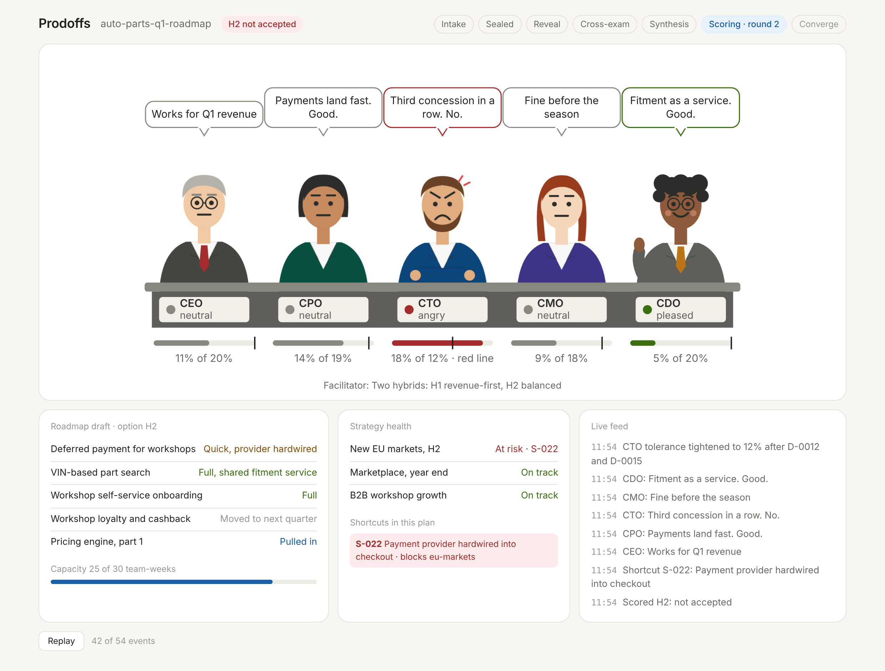

# Example: Q1 roadmap for an online auto parts retailer

A fictional company sells spare parts online to consumers and to independent repair workshops (B2B) in several European countries. It has 30 team-weeks for Q1 and three strategic bets for the year:

1. New EU markets in H2.
2. A marketplace for third-party sellers by year end.
3. B2B workshop growth.

It carries one old shortcut: **S-014**, prices and VAT hardcoded per country. The CTO already conceded twice on this module (D-0012, D-0015), so his tolerance is tightened to 12%.

## What happens in the sample session

| Round | Option | Result |
|---|---|---|
| 2 | H1, revenue-first | Rejected: quick VIN search creates S-023 (blocks the marketplace), S-014 stays open, CTO and CDO red lines |
| 2 | H2, balanced | Rejected: quick payments hardwire the provider (S-022 blocks EU markets); CTO at 18% of 12% |
| 3 | H2b, payments behind a layer | **Accepted.** CPO pays 3 weeks; all bets on track; 28 of 30 team-weeks |

Final brief: [`sample-session/brief.md`](sample-session/brief.md).

This sample session is hand-written to show the mechanics; for a real agent run see [`vin-buy-vs-build`](../vin-buy-vs-build).



## Files

| File | Role |
|---|---|
| `prodoffs.yaml` | Negotiation rules: tolerance, fairness strength, rounds |
| `strategy.yaml` | Strategic bets the future-proof check protects |
| `candidates.yaml` | Initiatives, versions, effort, shortcuts created or fixed |
| `mandates/*.yaml` | What each role owns, red lines, weighted requirements |
| `memory/shortcuts.yaml` | Open shortcuts and what they block |
| `memory/concessions.yaml` | Who gave in recently, which tightens tolerance |
| `memory/decisions/` | Past decisions the agents can cite |
| `sample-session/` | A recorded run: positions, critiques, options, scores, events, brief |

## Run it

From the repository root:

```bash
pip install pyyaml

# 1. Replay on the board
python3 -m http.server 8000
# open http://localhost:8000/board/?events=/examples/auto-parts-q1-roadmap/sample-session/events.jsonl

# 2. Recompute rounds 2 and 3
python3 scripts/prodoffs.py score examples/auto-parts-q1-roadmap --round 2 --session examples/auto-parts-q1-roadmap/sample-session --dry-run
python3 scripts/prodoffs.py score examples/auto-parts-q1-roadmap --round 3 --session examples/auto-parts-q1-roadmap/sample-session --dry-run

# 3. Rebuild events and brief after editing any file
bash examples/auto-parts-q1-roadmap/sample-session/rebuild.sh

# 4. Full session with the agents
claude
> Run a Prodoffs roadmap session for examples/auto-parts-q1-roadmap
```

Things worth trying:

- Set the CTO balance in `memory/concessions.yaml` to `0` and rescore round 2. His tolerance goes back to 20% and 18% fits, but H2 still fails: S-022 puts the EU launch at risk. History changes the tolerance; it does not hide a strategic risk.
- Lower `capacity_team_weeks` to 26 and rescore round 3. H2b no longer fits, and a real session would need another concession.
- Run step 4 with your own changes and see whether the agents find a different compromise.

A full run with step 4 writes a new session under `sessions/` and, only after your yes, updates `memory/`. Use `git checkout examples/` to reset.
