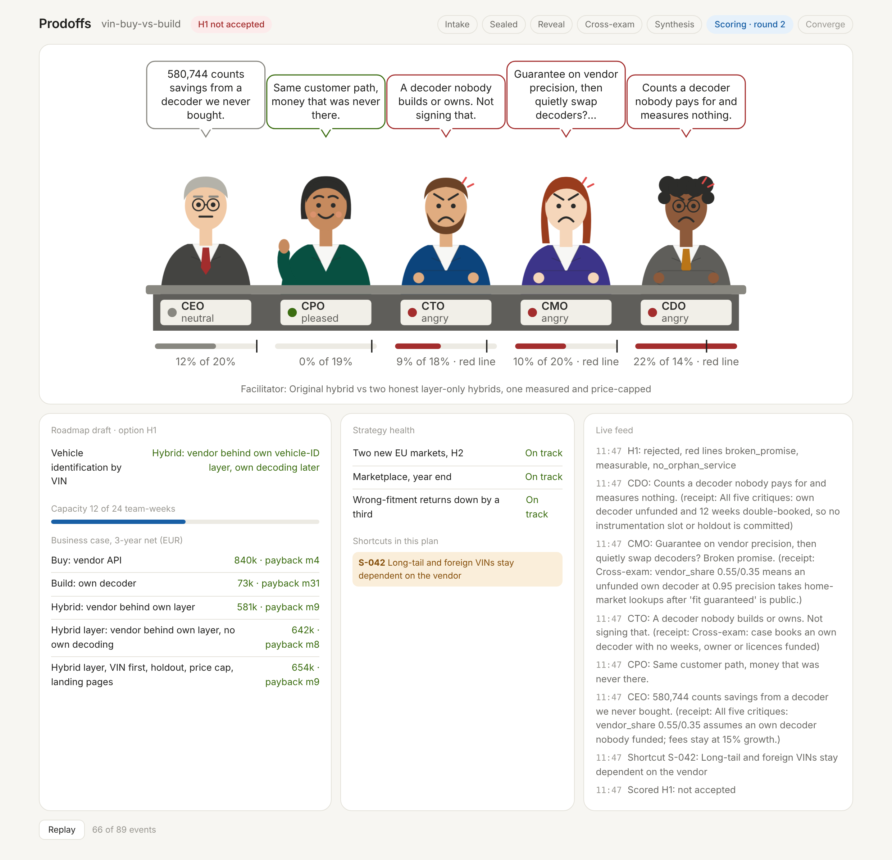

# Example: buy or build vehicle identification by VIN

A classic buy-versus-build trade-off, run end to end by the Prodoffs agents. **The sample session is a real run**: positions, critiques, options, scores, plan and dissent were written by the role agents; only the numbers were computed by `scripts/prodoffs.py`.

## The question

A fictional online auto parts retailer lets customers pick their vehicle from make, model and engine dropdowns. Many skip it or pick the wrong variant, so search shows parts that do not fit, conversion is low and a large share of returns are wrong-fitment returns. A VIN identifies the exact vehicle.

| Alternative | Effort | What it creates |
|---|---|---|
| **Buy**: vendor VIN-decoding API, direct integration | 4 team-weeks | S-040: search, cart and returns keyed to vendor vehicle IDs, which blocks the marketplace bet |
| **Build**: own decoder for home markets | 22 team-weeks | S-041: home markets only, which blocks the new-markets bet |
| **Hybrid**: vendor behind our own vehicle-ID layer, own decoding later | 12 team-weeks | S-042: long-tail VINs stay with the vendor; blocks nothing |

## The business case

`business_case.yaml` models the three effects the decision is about: search-to-order conversion, checkout completion and wrong-fitment returns, against vendor fees, build cost and upkeep. `prodoffs.py case` turns it into a 3-year view:

| Alternative | 3-year net (EUR) | Payback |
|---|---|---|
| Buy | 839,880 | month 4 |
| Build | 72,834 | month 31 |
| Hybrid | 580,744 | month 9 |

Return-rate and fitment-share inputs follow public industry reports for auto parts e-commerce (returns around 18 to 20%, close to half of them fitment-related); every other number is illustrative. Replace them with your own analytics.

## What happened in the run

1. **Sealed positions: unanimous.** All five roles picked hybrid on their own. Buy breaks the marketplace bet, build breaks the new-markets bet and misses the spring season.
2. **Cross-exam: the consensus was red-teamed.** Because the vote was unanimous, each role had to defend the best rejected option and attack the hybrid. All five independently found the same flaw: the hybrid's year 2 and 3 savings assumed an own decoder that its 12 team-weeks do not pay for, and nobody owned it.
3. **Synthesis: the facilitator corrected the business case** (in the session copy, not the workspace) and added two honest versions: `hybrid_layer` (vendor answers every VIN, no phantom savings) and `hybrid_layer_measured` (plus VIN entry first for spring, a 10% holdout, a 5% vendor price cap and VIN landing pages). Surprise: the honest hybrid was worth *more* (642k and 654k), because the phantom decoder's run cost exceeded the fees it was supposed to save once the vendor's monthly minimum was counted.
4. **Scoring.** The original hybrid (H1) was rejected on three red lines: CMO `broken_promise`, CDO `measurable`, CTO `no_orphan_service`. H2 failed the CDO's measurability red line. **H3 was accepted** with every role inside its tolerance, including the CDO, whose tolerance was tightened to 14% by past concessions.
5. **Plan and dissent.** Seven steps in 14 team-weeks: own vehicle-ID schema first, vendor contract with a price cap, VIN entry live by mid-January through our layer only, holdout and instrumentation from launch, migration off supplier IDs before the season (closes S-009), and a month-9 go/no-go on own decoding as a separate decision. Four recorded disagreements, each with a measurable condition to revisit.

Full brief: [`sample-session/brief.md`](sample-session/brief.md).



## Files

| File | Role |
|---|---|
| `strategy.yaml` | The question, context and three strategic bets |
| `candidates.yaml` | One candidate, three versions: buy, build, hybrid |
| `business_case.yaml` | Baseline metrics and the cost model of each alternative |
| `mandates/*.yaml` | What each role owns, red lines, weighted requirements |
| `memory/` | Open shortcut S-009, concession balances (CDO has been giving in), past decisions D-0016 and D-0018 |
| `sample-session/` | The recorded run, including the facilitator's corrected `candidates.yaml` and `business_case.yaml` |

## Run it

From the repository root, with `pip install pyyaml`:

```bash
# Replay on the board
python3 -m http.server 8000
# open http://localhost:8000/board/?events=/examples/vin-buy-vs-build/sample-session/events.jsonl

# The business case, as the agents saw it at the start and after the correction
python3 scripts/prodoffs.py case examples/vin-buy-vs-build --dry-run
python3 scripts/prodoffs.py case examples/vin-buy-vs-build --session examples/vin-buy-vs-build/sample-session --dry-run

# Rescore round 2
python3 scripts/prodoffs.py score examples/vin-buy-vs-build --round 2 --session examples/vin-buy-vs-build/sample-session --dry-run

# Your own run with the agents
claude
> Run a Prodoffs decision for examples/vin-buy-vs-build
```

Things worth trying: change `vin_entry_share` or `fee_per_lookup` in `business_case.yaml` and see whether buy's lead survives; set the CDO balance in `memory/concessions.yaml` to `0`; remove the marketplace bet from `strategy.yaml` and see whether the roles still refuse buy. Reset afterwards with `python3 scripts/prodoffs.py reset examples/vin-buy-vs-build --memory`.
